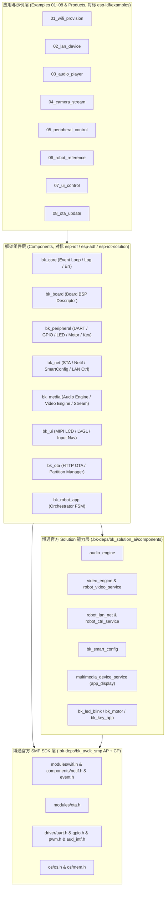

# BK Open Framework 组件与示例真实功能落地实施方案（对标 Espressif 开源体系）

> **状态：** 待执行 / 架构与实施方案归档  
> **参考开源标杆：** [Espressif Systems (`https://github.com/espressif`)](https://github.com/espressif) — `esp-idf`、`esp-bsp`、`esp-adf`、`esp-iot-solution`  
> **底层绑定版本：** `bekencorp/bk_avdk_smp` (`release/v4.0.1.11`, `584b947920c414230f9909375f008e7d6a2c6c6b`) + `bekencorp/bk_solution_ai` (`release/v4.0.1.11`, `a1e865e156e8dc31dfb360219c33a6a6d908ea98`)

---

## 1. 现状诊断：哪些是骨架/伪代码，哪些已接通 SDK？

通过对当前仓库 `examples/` 与 `components/` 全量代码的盘点，当前实现状态分为两类：

### 1.1 `examples/`（8 个示例全部为占位桩代码）
- `examples/01_wifi_provision/main.c` ~ `examples/08_ota_update/main.c` 目前全部只有 **5 行 `puts(...)` 打印**，既未 `#include` 框架组件头文件，也未在各自 `CMakeLists.txt` 中链接任何 `bk_*` 组件库，属于纯占位骨架。

### 1.2 `components/`（已具备基础状态机与部分 SDK 钩子，但核心数据通路尚未完全打通）

| 组件 | 当前已实现部分 | 当前缺失 / 仍为骨架的部分 |
| :--- | :--- | :--- |
| **`bk_core`** | 错误码映射 (`bk_err_t`)、同步回调数组 (`bk_event`)、运行状态字 | 缺少类似 `esp_event` 的 FreeRTOS 互斥锁 (`beken_mutex_t`) 并发保护与统一日志宏 (`BK_LOGI`/`BK_LOGE` 桥接) |
| **`bk_board`** | 静态板级配置表查询 (`bk_board_get_info`)、基础初始化钩子 | 缺少类似 `esp-bsp` 的板级一键外设按需使能接口（LED、按键、音频、LCD、摄像头、电机） |
| **`bk_peripheral`** | 仅支持单通道 `cp_uart0` (`bk_uart_init` / `write` / `read`) | 缺少 GPIO 输入输出、双色状态 LED (`bk_led_blink`)、PWM 电机驱动 (`bk_motor`)、按键事件服务 (`bk_key_app`) 等真实外设驱动封装 |
| **`bk_net`** | `bk_net` 已调 `bk_wifi_sta_start()`；`bk_provision` 已调 `bk_smart_config_init()`；`bk_lan` 已调 `robot_lan_net_*` | 缺少 SSID/Password 凭证配置 (`bk_wifi_sta_set_config`)、IPv4 地址/网关查询 (`bk_netif_get_ip4_config`)、底层 Wi-Fi/Netif 事件回调自动驱动 `bk_event` 状态流转，以及 `robot_ctrl_service` 局域网动作控制指令桥接 |
| **`bk_media`** | 仅在 `start()` 时调用了空参数 `bk_aud_intf_drv_init` / `media_app_camera_open`；`submit()` 为空操作 | 未接入 `bk_solution_ai/components/audio_engine`（PCM 播放 `audio_engine_write_data`、提示音播放 `audio_engine_play_array`、音量增减与麦克风电平读取）和 `video_engine` / `robot_video_service`（摄像头采集、预览、H264/JPEG 编码推流、码率与关键帧控制） |
| **`bk_ui`** | 仅在 `start()` 时调用 `lv_vendor_init`；`push_event()` 仅缓存最后一次事件 | 未接入 `multimedia_device_service` 的 MIPI LCD 背光与刷新 (`app_mipi_lcd_turn_on` / `app_mipi_lcd_flush`)、LVGL 渲染线程启停 (`lv_vendor_start` / `lv_vendor_stop`) 以及实体按键导航 (`bk_key_app_notify_ui_nav`) |
| **`bk_ota`** | 在 AP 核启用 `CONFIG_OTA_FUNCTION` 时调用 `bk_ota_start_download(url, OTA_WR_TO_FLASH)` | 缺少当前运行分区/目标升级分区查询 (`bk_ota_get_current_partition` / `bk_ota_get_update_partition`)、URL/版本校验及升级进度/结果事件派发 |
| **`bk_robot_app`** | 状态机转换枚举 (`BOOTING` -> `PROVISIONING` -> `READY` -> `ACTIVE` -> `OTA` -> `RECOVERING`) | 仅改变枚举值，未联动驱动 `bk_net`、`bk_media`、`bk_ui`、`bk_peripheral`、`bk_ota` 协同工作 |

---

## 2. 总体架构设计（对标 Espressif 开源体系）

参考乐鑫开源仓库的分层设计范式，构建 **四层双后端（Armino Target + Host POSIX Simulation）** 架构：

### 核心设计原则
1. **对标 Espressif 各仓库职责边界**：
   - **`esp-idf` (`esp_event` / `esp_netif` / `esp_wifi` / `esp_https_ota`)** $\rightarrow$ `bk_core`、`bk_net`、`bk_ota`
   - **`esp-bsp` (`bsp_board_init` / `bsp_display_start` / `bsp_leds_init`)** $\rightarrow$ `bk_board`、`boards/bk7259_robot`
   - **`esp-iot-solution` (`iot_button` / `led_indicator` / `mcpwm_motor`)** $\rightarrow$ `bk_peripheral`
   - **`esp-adf` (`audio_pipeline` / `i2s_stream` / `esp_video`)** $\rightarrow$ `bk_media`、`bk_ui`
2. **AP/CP 双核安全隔离**：
   - `bk7259` 采用 SMP/AMP 双核构建（`bk7259_ap` 应用核运行音视频、LVGL、SmartConfig、LAN 服务、HTTP OTA；`bk7259` CP 核运行底层通信与基础驱动）。
   - 所有对 `bk_solution_ai/components/*`（仅在 AP 核注册）及 AP 专属 SDK API（如 `bk_ota_start_download`）的调用，均通过精细化编译宏（如 `defined(CONFIG_MEDIA)`、`defined(CONFIG_LVGL)`、`defined(CONFIG_OTA_FUNCTION)` 等）保护，确保 `libbk_open_framework.a` 在 AP 与 CP 双核下均能零警告编译并打包进 `all-app.bin`。
3. **最小依赖边界守卫（Minimal Profile Boundary）**：
   - `examples/01_wifi_provision` 与 `examples/02_lan_device` 面向 `bk7259_minimal` profile，绝不直接引入专有云或 `bk_solution_ai` 耦合符号，严格通过 CI 的 `Verify minimal dependency boundary` 检查。

---

## 3. 组件层 (`components/`) 详细改造方案

### 3.1 `bk_core`（对标 `esp_common` + `esp_event`）
- **头文件与源码**：`components/bk_core/include/bk_core.h`、`components/bk_core/include/bk_event.h`、`components/bk_core/src/bk_core.c`、`components/bk_core/src/bk_event.c`
- **新增与增强能力**：
  - **并发安全事件总线**：在 Armino 目标端使用 `<os/os.h>` 的 `beken_mutex_t`（`rtos_init_mutex` / `rtos_lock_mutex` / `rtos_unlock_mutex`）保护订阅表与事件派发队列；支持按事件域（`BK_EVENT_DOMAIN_CORE`、`BK_EVENT_DOMAIN_NET`、`BK_EVENT_DOMAIN_MEDIA`、`BK_EVENT_DOMAIN_UI`、`BK_EVENT_DOMAIN_OTA`、`BK_EVENT_DOMAIN_PERIPHERAL`）投递带统计计数与时间戳的事件。
  - **统一日志与断言桥接**：新增 `BK_FRAMEWORK_LOGI(tag, fmt, ...)`、`BK_FRAMEWORK_LOGW`、`BK_FRAMEWORK_LOGE` 宏，在目标端映射到 `<components/log.h>` 的 `BK_LOGI`/`BK_LOGW`/`BK_LOGE`，在宿主机测试端映射到标准输出。

### 3.2 `bk_board` 与 `bk_peripheral`（对标 `esp-bsp` + `esp-iot-solution`）
- **头文件与源码**：`components/bk_board/include/bk_board.h`、`components/bk_peripheral/include/bk_peripheral.h`、`components/bk_peripheral/src/bk_peripheral.c`
- **真实底层驱动对接**：
  1. **UART 通信 (`cp_uart0` / `ap_uart1`)**：
     - 对接 `<driver/uart.h>`：`bk_uart_init()`、`bk_uart_write_bytes()`、`bk_uart_read_bytes()`、`bk_uart_deinit()`。
  2. **GPIO 通用数字输入输出**：
     - 新增 `bk_peripheral_gpio_set_level(pin, level)` 与 `bk_peripheral_gpio_get_level(pin, &level)`，对接 `<driver/gpio.h>` 的 `bk_gpio_enable_output`、`bk_gpio_set_output_high/low`、`bk_gpio_get_input`。
  3. **板载状态指示灯 (`bk_led_blink`)**：
     - 新增 `bk_peripheral_set_led(bk_led_id_t led, bk_led_state_t state)`，对接 `.bk-deps/bk_solution_ai/components/bk_led_blink/led_blink.h` 的 `led_driver_init()` 与 `led_app_set(LED_OFF_GREEN / LED_ON_GREEN / LED_FAST_BLINK_GREEN / LED_OFF_RED / LED_ON_RED / LED_FAST_BLINK_RED, ...)`（对应 `bk7259_robot` 板载 GPIO40 红灯、GPIO41 绿灯）。
  4. **PWM 电机控制 (`bk_motor`)**：
     - 新增 `bk_peripheral_set_motor(uint8_t duty_percent)`，对接 `.bk-deps/bk_solution_ai/components/bk_motor/motor.h` 的 `motor_open(PWM_MOTOR_CH_3)` / `motor_close(PWM_MOTOR_CH_3)`。
  5. **实体按键服务 (`bk_key_app`)**：
     - 新增 `bk_peripheral_key_service_start()`，对接 `.bk-deps/bk_solution_ai/components/bk_key_app/key_app_service.h` 的 `bk_key_service_init()`，并将按键动作通过 `bk_event` 广播。

### 3.3 `bk_net`（对标 `esp_wifi` + `esp_netif` + `wifi_provisioning` + `esp_local_ctrl`）
- **头文件与源码**：`components/bk_net/include/bk_net.h`、`components/bk_net/include/bk_provision.h`、`components/bk_net/include/bk_lan.h` 及对应 `src/*.c`
- **真实底层驱动对接**：
  1. **STA 凭证设置与连接管理 (`bk_net.c`)**：
     - 新增 `bk_net_set_credentials(const char *ssid, const char *password)`：在 Armino 下填充 `wifi_sta_config_t`，调用 `bk_wifi_sta_set_config(&sta_config)` 与 `bk_wifi_sta_start()`。
     - 新增 `bk_net_get_ip_info(bk_net_ip_info_t *out_info)`：调用 `<components/netif.h>` 的 `bk_netif_get_ip4_config(NETIF_IF_STA, &ip4_config)`，返回真实 IP、掩码、网关、DNS 字符串。
     - 注册 `<components/event.h>` 的 `EVENT_MOD_WIFI` (`EVENT_WIFI_STA_CONNECTED` / `EVENT_WIFI_STA_DISCONNECTED`) 与 `EVENT_MOD_NETIF` (`EVENT_NETIF_GOT_IP4`) 回调，自动触发 `bk_net_notify_connected()` / `bk_net_notify_disconnected()` 并向 `bk_event` 广播。
  2. **SmartConfig / BLE 配网服务 (`bk_provision.c`)**：
     - 对接 `.bk-deps/bk_solution_ai/components/bk_smart_config/include/bk_smart_config.h`：`bk_smart_config_init()`、`bk_AirKiss_start()` / `bk_AirKiss_stop()`，支持超时回退与配网凭证自动写入 `bk_net`。
  3. **局域网发现、控制与信令服务 (`bk_lan.c`)**：
     - 同时对接 `.bk-deps/bk_solution_ai/components/robot_lan_net/include/robot_lan_net.h`（`robot_lan_net_init` / `start` / `stop` / `send_text` / `broadcast_state` / `register_rx_cb`）和 `.bk-deps/bk_solution_ai/components/robot_ctrl_service/include/robot_ctrl_service.h`（`robot_ctrl_service_init` / `start` / `stop` / `notify`），支持局域网 JSON/二进制控制指令收发与状态通知。

### 3.4 `bk_media`（对标 `esp-adf` + `esp-video`）
- **头文件与源码**：`components/bk_media/include/bk_media.h`、`components/bk_media/src/bk_media.c`
- **真实底层驱动对接**：
  1. **音频引擎管线 (`audio_engine.h`)**：
     - `bk_media_audio_start()` 调用 `audio_engine_init()` 与 `audio_engine_start(&cfg)`（默认 16kHz、单声道、16-bit PCM）。
     - `bk_media_audio_submit(pcm_data, size)` 真实调用 `audio_engine_write_data((const int16_t *)pcm_data, sample_count, timeout_ms)` 写入硬件扬声器播放队列。
     - 新增 `bk_media_audio_set_volume(level)` / `bk_media_audio_get_volume(&level)` / `bk_media_audio_get_mic_level(&level)`，对接 `audio_engine_volume_increase()` / `audio_engine_volume_decrease()` / `audio_engine_volume_get_level()` / `audio_engine_get_mic_level()`。
  2. **视频采集与编码推流管线 (`video_engine.h` + `robot_video_service.h`)**：
     - `bk_media_video_start()` 调用 `video_engine_init()`、`video_engine_start(&vcfg)` 及 `robot_video_service_init()` / `robot_video_service_start()`。
     - 新增 `bk_media_video_request_keyframe()` 与 `bk_media_video_set_bitrate(kbps)`，对接 `robot_video_service_request_keyframe()` 与 `robot_video_service_set_bitrate(kbps)`。

### 3.5 `bk_ui`（对标 `esp_lvgl_port`）
- **头文件与源码**：`components/bk_ui/include/bk_ui.h`、`components/bk_ui/src/bk_ui.c`
- **真实底层驱动对接**：
  - `bk_ui_start()`：调用 `app_mipi_lcd_turn_on()`（来自 `multimedia_device_service/include/app_display.h`）及 `lv_vendor_init(&lv_vnd_config)` + `lv_vendor_start()`。
  - `bk_ui_stop()`：调用 `lv_vendor_stop()` 与 `app_mipi_lcd_turn_off()`。
  - `bk_ui_push_event(event_code)`：除更新 UI 状态模型外，在目标端调用 `bk_key_app_notify_ui_nav((uint8_t)event_code)` 驱动机器人 UI 导航状态切换，并支持通过 `bk_ui_flush_frame()` 调用 `app_mipi_lcd_flush()`。

### 3.6 `bk_ota`（对标 `esp_https_ota` + `esp_ota_ops`）
- **头文件与源码**：`components/bk_ota/include/bk_ota.h`、`components/bk_ota/src/bk_ota.c`
- **真实底层驱动对接**：
  - 新增 `bk_ota_get_partition_info(bk_ota_partition_info_t *out_info)`：在 AP 核调用 `<modules/ota.h>` 的 `bk_ota_get_current_partition()` 与 `bk_ota_get_update_partition()` 查询当前启动分区与目标升级分区。
  - `bk_ota_start(url)`：校验 HTTP/HTTPS URL 合法性、发布 `BK_OTA_STATE_DOWNLOADING` 事件、调用 `bk_ota_start_download(url, OTA_WR_TO_FLASH)`，并根据返回值更新为 `BK_OTA_STATE_SUCCEEDED` 或 `BK_OTA_STATE_FAILED`。

### 3.7 `bk_robot_app`（全栈业务编排器）
- **头文件与源码**：`components/bk_robot_app/include/bk_robot_app.h`、`components/bk_robot_app/src/bk_robot_app.c`
- **真实编排逻辑**：
  - `bk_robot_app_init()`：依次初始化 `bk_core`、`bk_board`、`bk_peripheral`、`bk_net`、`bk_provision`、`bk_lan`、`bk_media`、`bk_ui`、`bk_ota`，并订阅网络/配网/媒体/OTA 事件。
  - 状态机自动联动：
    - 进入 `PROVISIONING`：点亮快闪配网指示灯、启动 `bk_provision_start()`、在 UI 推送配网提示事件。
    - 配网完成进入 `READY`：常亮绿色指示灯、启动 `bk_lan_start()` 局域网发现与控制服务。
    - 进入 `ACTIVE`：启动 `bk_media_audio_start()` 与 `bk_media_video_start()`，开启音视频交互。
    - 进入 `OTA`：安全停止音视频流以释放内存带宽，启动 `bk_ota_start(url)`。

---

## 4. 八个示例 (`examples/01_*` ~ `08_*`) 真实业务改造方案

所有 8 个示例均修改各自 `CMakeLists.txt` 链接真实框架组件库，并在 `main.c` 中实现完整的初始化、事件回调、业务执行、状态校验与资源释放闭环（既可在宿主机 CTest 下毫秒级运行验证，也可编译进目标板固件执行）：

| 示例目录 | 对标 Espressif 示例 | 链接组件 | 实现的真实业务流程 |
| :--- | :--- | :--- | :--- |
| **`01_wifi_provision`** | `esp-idf/examples/provisioning/wifi_prov_mgr` | `bk_core`, `bk_board`, `bk_net` | 初始化核心与事件总线 $\rightarrow$ 注册网络与配网事件回调 $\rightarrow$ 启动 SmartConfig 配网状态机 $\rightarrow$ 注入/接收 SSID & Password 凭证 $\rightarrow$ 启动 STA 连接并获取 IPv4 地址信息 $\rightarrow$ 验证重连与安全退出（**严格保持 minimal 依赖边界，不含任何 solution/专有云符号**） |
| **`02_lan_device`** | `esp-idf/examples/protocols/esp_local_ctrl` | `bk_core`, `bk_board`, `bk_net` | 启动 Wi-Fi STA 并上线 $\rightarrow$ 启动 `bk_lan` 局域网发现与控制服务 $\rightarrow$ 注册局域网指令回调 $\rightarrow$ 处理局域网 `PING`/`STATUS`/`ACTION` 控制报文并回传 JSON 响应 $\rightarrow$ 统计收发计数并清理（**严格保持 minimal 依赖边界**） |
| **`03_audio_player`** | `esp-adf/examples/player/pipeline_play_pcm` | `bk_core`, `bk_board`, `bk_media` | 查询板级音频能力 $\rightarrow$ 初始化 `bk_media` 音频引擎（16kHz/16-bit/Mono） $\rightarrow$ 合成一段标准 440Hz 正弦波 PCM 音频帧并循环提交 `bk_media_audio_submit()` $\rightarrow$ 动态调节音量与读取麦克风电平 $\rightarrow$ 停止并释放音频管线 |
| **`04_camera_stream`** | `esp-video/examples/capture_stream` | `bk_core`, `bk_board`, `bk_media` | 查询板级 DVP/MIPI 摄像头能力 $\rightarrow$ 初始化并启动 `bk_media_video_start()` 视频采集与编码服务 $\rightarrow$ 设定目标码率、请求关键帧 (IDR)、提交并统计视频帧流转 $\rightarrow$ 停止视频引擎 |
| **`05_peripheral_control`** | `esp-iot-solution/examples/peripherals` | `bk_core`, `bk_board`, `bk_peripheral` | 初始化 `bk_board` 与 `bk_peripheral` $\rightarrow$ 打开 `cp_uart0` 执行串口自环收发校验 $\rightarrow$ 切换板载红/绿状态 LED 模式 $\rightarrow$ 控制 GPIO 高低电平与 PWM 电机占空比 $\rightarrow$ 启动按键扫描服务并关闭释放 |
| **`06_robot_reference`** | `esp-box/examples/factory_demo` | 全组件 (`bk_robot_app` 等) | 完整串联机器人生命周期：`bk_robot_app_init()` $\rightarrow$ `BOOTING` 自检板卡能力 $\rightarrow$ `PROVISIONING` 配网并连接 Wi-Fi $\rightarrow$ `READY` 开启局域网控制与 UI 状态屏 $\rightarrow$ `ACTIVE` 开启双向音频与摄像头视频流 $\rightarrow$ 模拟网络抖动自动 `RECOVERING` 恢复 |
| **`07_ui_control`** | `esp-bsp/examples/display_lvgl` | `bk_core`, `bk_board`, `bk_ui` | 查询板级 MIPI LCD 显示能力 $\rightarrow$ 启动 `bk_ui_start()` 点亮屏幕并初始化 LVGL 渲染管线 $\rightarrow$ 依次投递按键导航与状态更新事件 (`bk_ui_push_event`) $\rightarrow$ 触发帧刷新 (`bk_ui_flush_frame`) 并校验事件统计 $\rightarrow$ 停止 UI 服务 |
| **`08_ota_update`** | `esp-idf/examples/system/ota/native_ota_example` | `bk_core`, `bk_board`, `bk_net`, `bk_ota` | 确认网络就绪 $\rightarrow$ 查询当前运行分区与目标升级分区信息 (`bk_ota_get_partition_info`) $\rightarrow$ 拦截非法 URL 测试防御逻辑 $\rightarrow$ 发起固件升级 `bk_ota_start("https://ota.beken.example/bk7259_robot_v4.0.1.11.bin")` $\rightarrow$ 监听 OTA 状态事件直至完成 |

---

## 5. 分阶段执行与验证计划（4 个 Phase）

每个 Phase 完成后均执行 **宿主机单元测试 (`ctest`) + Python 工具链与边界检查 (`pytest`) + BK7259 AP/CP 真机固件交叉编译 (`./tools/sdk_release_gate.sh`)**，并立即提交推送到 GitHub：

- [ ] **Phase 1：强化核心层 (`bk_core`) 与板级外设驱动层 (`bk_board`, `bk_peripheral`)**
  - 完成 `bk_event` RTOS 互斥锁保护与日志宏桥接。
  - 完成 `bk_peripheral` 对 UART、GPIO、LED (`bk_led_blink`)、电机 (`bk_motor`)、按键 (`bk_key_app`) 的真实 SDK/Solution 绑定与单元测试扩展。
- [ ] **Phase 2：完善网络配网 (`bk_net`)、局域网控制 (`bk_lan`) 与固件升级 (`bk_ota`)**
  - 完成 `bk_net_set_credentials`、`bk_net_get_ip_info`、Wi-Fi/Netif 事件回调、`robot_ctrl_service` 桥接及 `bk_ota` 分区查询接口。
- [ ] **Phase 3：打通音视频引擎 (`bk_media`)、显示交互 (`bk_ui`) 与机器人编排器 (`bk_robot_app`)**
  - 对接 `audio_engine`、`video_engine`、`robot_video_service`、`app_display` (`app_mipi_lcd_*`) 与 `lv_vendor_*`。
  - 更新 `tools/spikes/bk7259_component_probe/bk_open_framework.cmake`，在 AP 核 (`bk7259_ap`) 编译时声明对应的 `PRIV_REQUIRES` 组件依赖。
- [ ] **Phase 4：全面重写 `examples/01_*` ~ `08_*` 真实业务逻辑与回归验证**
  - 更新 8 个示例的 `CMakeLists.txt` 与 `main.c`，新增端到端示例测试，确保 `ctest`、`pytest`、GitHub Actions CI 以及 `./tools/sdk_release_gate.sh` (`all-app.bin` 固件打包) 100% 通过。
