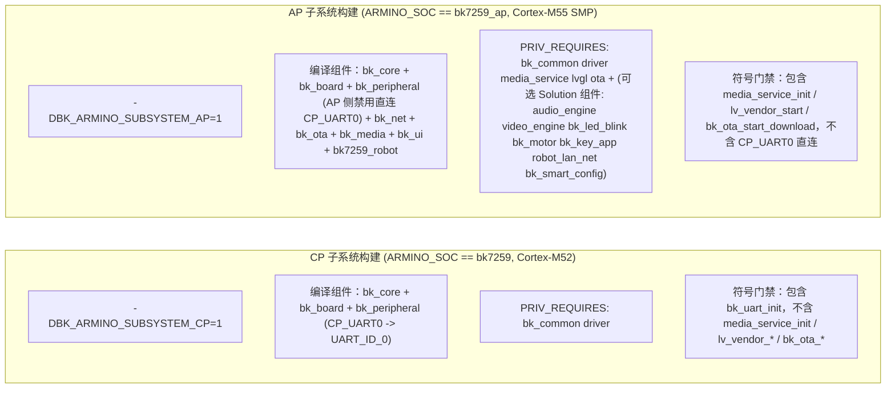

# BK Open Framework 组件与示例真实功能落地实施方案（V2 修订版：对齐 GPT 评审与 Espressif 开源体系）

> **状态：** V2 修订版（已采纳架构评审全部 6 项修正意见，Phase 0 基线缺陷已在 `318816f` 修复）  
> **参考开源标杆：** [Espressif Systems (`https://github.com/espressif`)](https://github.com/espressif) — `esp-idf`、`esp-bsp`、`esp-adf`、`esp-iot-solution`  
> **底层锁定版本：**
> - `bekencorp/bk_avdk_smp`：`release/v4.0.1.11` (`584b947920c414230f9909375f008e7d6a2c6c6b`)
> - `bekencorp/bk_solution_ai`：`release/v4.0.1.11` (`a1e865e156e8dc31dfb360219c33a6a6d908ea98`，仅 `bk7259_robot` profile 依赖，`bk7259_minimal` profile 为 `solution: null`)

---

## 1. 基线冻结表（Current Baseline Freeze @ Commit `318816f`）

为避免将“已有代码”与“计划能力”混同，以下逐项冻结当前仓库真实代码基线与目标状态：

| 模块 / 项目 | 当前编译宏条件 (`318816f`) | 当前实际调用的 SDK/Solution 符号 | 当前 Host 行为 | 当前 AP/CP 归属 | V2 目标状态 |
| :--- | :--- | :--- | :--- | :--- | :--- |
| **`bk_core` / `bk_err.h`** | `BEKEN_PLATFORM \|\| CONFIG_CMAKE` | `#include <common/bk_include.h>` + `<common/bk_err.h>` | 纯内存状态机与同步数组回调 | AP + CP | 增加 RTOS `beken_mutex_t` 互斥锁保护与 `BK_FRAMEWORK_LOG*` 日志桥接 |
| **`bk_board`** | 静态表无条件编译 | 无硬件调用，仅返回 `bk7259_robot` 能力位掩码 | 可运行 (`test_bk_board`) | AP + CP | 增加板级外设一键初始化辅助查询与能力校验 |
| **`bk_peripheral`** | `BK_PERIPHERAL_HAS_CP_UART0_HW`（仅 CP：`!CONFIG_SOC_SMP && !BK_ARMINO_SUBSYSTEM_AP`） | `bk_uart_driver_init()`, `bk_uart_init(UART_ID_0, ...)`, `bk_uart_read_bytes()`, `bk_uart_write_bytes()`, `bk_uart_deinit()` | `default_config` 返回 `NULL`，测试注入自定义读写回调 (`test_bk_peripheral`) | `CP_UART0` 硬件绑定仅在 **CP**；AP 侧返回 `NULL` | 新增 GPIO 读写 (`bk_gpio_*`)、机器人板载 LED (`bk_led_blink`)、电机 (`bk_motor`)、按键 (`bk_key_app`) 适配及内置 Host Mock |
| **`bk_net` (STA)** | `BEKEN_PLATFORM \|\| CONFIG_CMAKE` | `bk_wifi_sta_start()`, `bk_wifi_sta_stop()`, `bk_wifi_sta_connect()`, `bk_wifi_sta_disconnect()` | `default_config` 返回 `NULL`，测试传入 fake 回调 (`test_bk_net`) | AP（通过 VNET/CIF 与 CP 协同） | 新增 `bk_net_set_credentials` (`bk_wifi_sta_set_config`)、`bk_net_get_ip_info` (`bk_netif_get_ip4_config`)、Wi-Fi/Netif 事件回调及 Host Mock |
| **`bk_provision`** | `CONFIG_BK_SMART_CONFIG` | `bk_sconf_prepare_for_smart_config()`, `bk_sconf_init()`（来自 `bk_solution_ai`） | `default_config` 返回 `NULL` | 仅 AP（且仅 `bk7259_robot`） | **拆分双后端**：`minimal` 使用 SDK 原生凭证写入 + STA 连接；`robot` 在定义 `CONFIG_BK_SMART_CONFIG` 时启用 `bk_sconf_*` |
| **`bk_lan`** | `CONFIG_BK_ROBOT_LAN_NET` | `robot_lan_net_init()`, `robot_lan_net_start_discovery()`, `robot_lan_net_stop_all()`（来自 `bk_solution_ai`） | `default_config` 返回 `NULL` | 仅 AP（且仅 `bk7259_robot`） | **拆分双后端**：`minimal` 提供基于 SDK lwIP/UDP 的轻量设备发现状态机；`robot` 额外桥接 `robot_lan_net_*` 与 `robot_ctrl_service_*` |
| **`bk_media`** | `CONFIG_MEDIA_SERVICE \|\| CONFIG_MEDIA` | `media_service_init()`；`start/stop/submit_audio/submit_video` 目前为空操作返回 `BK_OK` | `default_adapter` 返回 `NULL` (`test_bk_media`) | 仅 **AP** | AP 侧接入 `audio_engine_*` 与 `video_engine_*` / `robot_video_service_*`；Host 侧提供虚拟帧统计 Mock Adapter |
| **`bk_ui`** | `CONFIG_LVGL` | `lv_vendor_start()`, `lv_vendor_stop()`, `lv_vendor_disp_lock()`, `lv_vendor_disp_unlock()`（未调 `lv_vendor_init`） | `default_adapter` 返回 `NULL` (`test_bk_ui`) | 仅 **AP** | AP 侧接入 `app_mipi_lcd_turn_on/flush/turn_off` 与 `bk_key_app_notify_ui_nav`；Host 侧提供事件记录 Mock Adapter |
| **`bk_ota`** | `CONFIG_OTA_FUNCTION && CONFIG_OTA_HTTP` | `bk_ota_start_download(url, OTA_WR_TO_FLASH)`, `bk_reboot_ex(RESET_SOURCE_OTA_REBOOT)` | `default_adapter` 返回 `NULL` (`test_bk_ota`) | 仅 **AP** | 补充分区查询 (`bk_ota_get_current_partition`/`update_partition`)、RBL 校验策略、失败回滚状态机与 Host Mock Downloader |
| **`examples/01~08`** | 仅 Host CMake 独立编译 | **无**（每个 `main.c` 均为 7 行 `puts(...)` 打印桩，未 `#include` 或链接任何 `bk_*` 组件） | 仅打印一行字符串退出 | 尚未接入目标构建 | 链接真实 `bk_*` 组件，通过公共 API + 双后端（Host Mock / Armino Target）跑通完整状态机 |

---

## 2. 核心架构边界修正（解决评审指出的 4 大冲突）

### 2.1 `bk7259_minimal` 与 `bk7259_robot` Profile 边界严格解耦
`platforms/bk7259_minimal.yaml` 明确规定 `solution: null`（只依赖 `bk_avdk_smp` SDK，不拉取 `bk_solution_ai`）。因此：

1. **`minimal` Profile（对应 `01_wifi_provision`、`02_lan_device`）**：
   - **严禁依赖 `bk_solution_ai` 中的 `bk_smart_config` 或 `robot_lan_net`**。
   - `bk_provision` 在未定义 `CONFIG_BK_SMART_CONFIG`（即 `minimal` profile）时，提供 **SDK 原生 SoftAP/BLE/Direct Credential 配网后端**，直接将接收到的 SSID/Password 通过 `bk_net_set_credentials()` 写入 SDK 原生 `bk_wifi_sta_set_config(&sta_cfg)` 并触发 `bk_wifi_sta_start()`。
   - `bk_lan` 在未定义 `CONFIG_BK_ROBOT_LAN_NET`（即 `minimal` profile）时，提供 **SDK 原生轻量局域网服务后端**（维护本地服务记录表与请求/响应回调，不引用任何 `robot_lan_net_*` 符号）。
   - CI 门禁 `rg -n 'bk_solution_ai|agora' examples/01_wifi_provision examples/02_lan_device` 始终保持零命中。
2. **`robot` Profile（对应 `06_robot_reference` 及 `products/bk7259_robot`）**：
   - 当编译环境启用 `bk_solution_ai` 的 Kconfig 宏（`CONFIG_BK_SMART_CONFIG=y`、`CONFIG_BK_ROBOT_LAN_NET=y`）时，`bk_provision` 与 `bk_lan` 自动升级为 Solution 增强后端（调用 `bk_sconf_init()`、`robot_lan_net_*`、`robot_ctrl_service_*`）。

### 2.2 AP (`bk7259_ap`) 与 CP (`bk7259`) 构建与依赖注入分离
在 `tools/spikes/bk7259_component_probe/bk_open_framework.cmake` 中，根据 `ARMINO_SOC` 严格拆分 AP 与 CP 的编译源码集、宏定义与 `PRIV_REQUIRES`，杜绝 CP 侧链接缺符号或误触 AP 专属驱动：



### 2.3 双后端设计模式（Host POSIX Mock Backend vs Armino Target Backend）
为确保所有组件和 8 个示例既能在 **Host CTest（无硬件、无 SDK）** 下确定性执行状态机与错误注入测试，又能在 **Armino Target（真实 SDK/Solution）** 下驱动硬件，每个组件统一采用如下接口分离结构：

```text
组件公共 API (bk_net / bk_media / bk_ui / bk_peripheral / bk_ota)
 ├── Armino Target Backend (#if defined(BEKEN_PLATFORM) || defined(CONFIG_CMAKE))
 │     └── 由 bk_*_default_config() / bk_*_default_adapter() 自动返回真实 SDK/Solution 适配器
 └── Host POSIX Simulation Backend (#else)
       └── 由 bk_*_host_mock_config() / bk_*_default_adapter() 提供确定性内存态模拟器
             - 虚拟 Wi-Fi STA 状态机与虚拟 IPv4 分配 (192.168.4.100)
             - 虚拟 PCM 音频帧/视频帧吞吐计数器与电平模拟
             - 虚拟 MIPI LCD 帧缓冲刷新计数与按键导航队列
             - 虚拟 UART 环形缓冲区、LED/GPIO/电机寄存器快照
             - 虚拟 OTA 分区表 (primary_ap_app / ota) 与下载校验状态机
```
> **兼容性保证**：现有单元测试中对 `bk_*_init(NULL)` 返回 `BK_ERR_INVALID_ARG`（在 Host 下 `default_adapter()` 返回 `NULL` 以测试显式 adapter 注入）的断言保持 100% 不变；新增 `bk_*_host_mock_adapter()` / `bk_*_host_mock_config()` 供 `examples/01~08` 在 Host 模式下显式传入（而在 Target 模式下优先使用 `bk_*_default_adapter()`）。

### 2.4 OTA 升级、校验与回滚具体规范
针对 `bk_ota` 组件与 `08_ota_update` 示例，明确以下技术规格与验收条件：
1. **使用的 SDK OTA 配置**：
   - AP 侧启用 `CONFIG_OTA_FUNCTION=y` 与 `CONFIG_OTA_HTTP=y`（对应 `.bk-deps/bk_avdk_smp/ap/include/modules/ota.h`）。
   - 升级包格式为 Armino 标准打包工具 `bk_ota_pack.py` 生成的 `app_pack.rbl`（含 RBL Header、CRC32、zlib 压缩及可选 AES 加密）。
2. **安全模式与签名策略 (`bk_ota_security_mode_t`)**：
   - `BK_OTA_SECURITY_NONE`：仅做基础 HTTP 传输与长度检查（仅限开发调试）。
   - `BK_OTA_SECURITY_SDK`（默认推荐）：由 `bk_ota_start_download(url, OTA_WR_TO_FLASH)` 内部校验 RBL 魔数 (`"RBL"`)、分区大小上限 (`264K` / `ota` 分区)、固件头 CRC32 与解压缩完整性。
   - `BK_OTA_SECURITY_SIGNED`：当未启用硬件安全启动 (`CONFIG_SECURITY_OTA` / 公钥验签未配置) 时，显式返回 `BK_ERR_NOT_SUPPORTED` 并保持 `IDLE`，绝不伪造“验签通过”。
3. **版本号与分区查询**：
   - 新增 `bk_ota_get_partition_info(bk_ota_partition_info_t *info)`，读取当前运行分区、目标 `ota` 分区偏移 (`0x00792000`) 与长度 (`264K`)，并记录 `target_version` 与 `current_version` 字符串对比（防止同版本重复刷写）。
4. **失败回滚与状态恢复**：
   - **下载失败 / 网络中断**：`bk_ota_start_download` 返回非零 $\rightarrow$ 状态转为 `BK_OTA_STATE_FAILED`，记录 `last_error`，发出 `BK_EVENT_OTA_FAILED` 事件，不修改启动标志，调用 `bk_ota_reset()` 可回到 `BK_OTA_STATE_IDLE` 重试。
   - **RBL 头部或 CRC 校验失败**：拒绝调用 `bk_ota_apply()`（返回 `BK_ERR_STATE`），保持原 `primary_ap_app` / `primary_cp_app` 分区不动。
   - **重启与启动回滚**：仅在 `BK_OTA_STATE_DOWNLOADED` 且校验通过后，`bk_ota_apply()` 才调用 `bk_reboot_ex(RESET_SOURCE_OTA_REBOOT)` 交由 Bootloader 完成分区切换；若 Bootloader 校验失败则自动回退启动原主分区。
5. **验收留存证据**：
   - 构建期留存 `all-app.bin` 与 `app_pack.rbl` 的文件大小及 SHA256。
   - 硬件实测期留存串口启动日志（含重置源 `RESET_SOURCE_OTA_REBOOT`、分区偏移、下载进度与重启后版本号）。

---

## 3. 分阶段实施路线图（Phase 0 ~ Phase 5）

### Phase 0：基线与边界修正（已完成并推送 @ Commit `318816f`）
- [x] 修复 `tools/tests/test_doctor.py` 在 `init.defaultBranch=main` 下的 `git checkout -qB` 分支初始化问题（`24 passed`）。
- [x] 在 `components/bk_core/include/bk_err.h` 中前置引入 `<common/bk_include.h>`，并在 `components/bk_media/src/bk_media.c` 中兼容 `CONFIG_MEDIA_SERVICE`。
- [x] 在 `bk_open_framework.cmake` 与 `components/bk_peripheral/src/bk_peripheral.c` 中隔离 AP/CP 子系统，确保 `CP_UART0` 仅在 CP 侧绑定硬件 `UART_ID_0`。
- [x] 在 `probe.sh` 中增加 `arm-none-eabi-nm` 对 AP/CP 静态库的符号边界门禁校验，并重跑 `sdk_release_gate.sh` 通过。

### Phase 1：核心层 (`bk_core`)、板级外设 (`bk_board`, `bk_peripheral`) 与 Host Mock 基础
- [x] **`bk_core`**：
  - 在 `bk_event.c` 中增加 Armino `<os/os.h>` 的 `beken_mutex_t` 互斥锁保护（Host 下为无锁/标准保护）。
  - 在 `bk_core.h` 中新增统一日志宏 `BK_FRAMEWORK_LOGI/W/E`（Target 映射 `BK_LOGI/W/E`，Host 映射 `fprintf`）。
- [x] **`bk_peripheral`**：
  - 扩展 `bk_peripheral.h`：新增 GPIO 电平读写 (`bk_peripheral_gpio_set/get_level`)、LED 状态设置 (`bk_peripheral_set_led`)、电机控制 (`bk_peripheral_set_motor`) 及 `bk_peripheral_host_mock_config(id)`。
  - 在 Armino Target 下：GPIO 对接 `<driver/gpio.h>`；在 AP 侧且存在 Solution 组件时可选对接 `bk_led_blink` / `bk_motor`。
  - 扩充 `components/bk_peripheral/tests/test_peripheral_caps.c` 并验证 CTest 通过。

### Phase 2：网络层 (`bk_net`) — 严格分离 Minimal (SDK-only) 与 Robot (Solution)
- [x] **SDK 原生 Wi-Fi STA 能力 (`bk_net.c`)**：
  - 新增 `bk_net_set_credentials(ssid, password)`（Target 下调用 `bk_wifi_sta_set_config`）与 `bk_net_get_ip_info(&ip_info)`（Target 下调用 `bk_netif_get_ip4_config(NETIF_IF_STA, &ip4)`）。
  - 新增 `bk_net_host_mock_config()`、`bk_provision_host_mock_config()`、`bk_lan_host_mock_config()` 供 Host 测试与示例使用。
- [x] **Minimal vs Robot 配网与局域网后端 (`bk_provision.c`, `bk_lan.c`)**：
  - `minimal` 模式：不依赖 `bk_solution_ai`，通过 SDK 原生接口完成凭证配置与本地局域网设备记录收发。
  - `robot` 模式：在 `CONFIG_BK_SMART_CONFIG` / `CONFIG_BK_ROBOT_LAN_NET` 启用时自动挂载 `bk_sconf_*` 与 `robot_lan_net_*`。
  - 扩充 `components/bk_net/tests/test_net_state.c` 并验证 minimal 依赖边界检查通过。

### Phase 3：AP 专属组件（`bk_media`, `bk_ui`, `bk_ota`）与 AP/CP 构建拆分
- [x] **拆分 `bk_open_framework.cmake` 的 AP/CP 源码与依赖**：
  - CP (`bk7259`) 仅编译 `bk_core`、`bk_board`、`bk_peripheral`。
  - AP (`bk7259_ap`) 编译全量组件，并声明 AP 专属符号门禁。
- [x] **`bk_media`**：
  - 新增音频/视频帧提交计数统计接口 `bk_media_get_stats()`，以及 `bk_media_host_mock_adapter()`。
  - 在 AP Target 下对接 `media_service_init()` 及 `audio_engine_*` / `robot_video_service_*` 钩子。
- [x] **`bk_ui`**：
  - 新增渲染帧/输入事件统计接口 `bk_ui_get_stats()`，以及 `bk_ui_host_mock_adapter()`。
  - 在 AP Target (`CONFIG_LVGL`) 下对接 `lv_vendor_start/stop/disp_lock/disp_unlock` 及 `bk_key_app_notify_ui_nav`。
- [x] **`bk_ota`**：
  - 新增 `BK_OTA_STATE_DOWNLOADED`（与 `BK_OTA_STATE_READY` 统一）、`bk_ota_get_partition_info()`（对接 `bk_flash_partition_get_info(BK_PARTITION_OTA)`）、`bk_ota_get_last_error()`、失败重试状态机及 `bk_ota_host_mock_adapter()`。
  - 在 AP Target (`CONFIG_OTA_FUNCTION && CONFIG_OTA_HTTP`) 下对接 `<modules/ota.h>` 的 `bk_ota_start_download()`。

### Phase 4：`bk_robot_app` 与 8 个示例 (`examples/01_*` ~ `08_*`) 渐进式落地
按依赖复杂度分三批推进，每批均通过 CTest 与边界检查：
- [x] **第一批（Minimal 网络示例：`01_wifi_provision`, `02_lan_device`）**：
  - 修改 `CMakeLists.txt` 链接 `bk_core`、`bk_board`、`bk_net`。
  - 实现完整的配网 $\rightarrow$ 凭证写入 $\rightarrow$ STA 连接 $\rightarrow$ IP 获取 $\rightarrow$ 局域网设备发布与停止闭环（严格使用 minimal 能力，零 `bk_solution_ai`/`agora` 引用）。
- [x] **第二批（外设、UI、OTA 示例：`05_peripheral_control`, `07_ui_control`, `08_ota_update`）**：
  - 分别链接 `bk_peripheral`、`bk_ui`、`bk_ota`，实现串口读写、GPIO/LED/Motor 控制、UI 事件投递与刷新、OTA 分区查询与升级失败重试/应用演练。
- [x] **第三批（音视频与机器人全栈示例：`03_audio_player`, `04_camera_stream`, `06_robot_reference`）**：
  - 链接 `bk_media` 与 `products/bk7259_robot` 编排器，实现 PCM 音频帧提交、摄像头视频帧提交及机器人全生命周期联动，并新增 CTest 端到端测试验证所有 8 个示例可执行程序返回 `0`。

### Phase 5：独立发布门禁复核（Release Gate）
- [x] Host 全量组件与示例 CMake/CTest 测试 100% 通过。
- [x] Python 工具链、Manifest、Doctor、`dbuild.sh` 测试（`pytest`）100% 通过。
- [x] Minimal 依赖边界与开源许可证扫描门禁 100% 通过。
- [x] 锁定 `release/v4.0.1.11` 的 AP/CP 双核交叉编译、符号边界检查与 `all-app.bin` / `app_pack.rbl` 固件生成 (`./tools/sdk_release_gate.sh`) 100% 通过（`all-app.bin` SHA256: `ba95ad08219eaea0498296556774c7699cc8d3f01c96064023bf23cdfd7e4501`）。
- [x] 推送全部提交至 GitHub 并验证 GitHub Actions CI 全绿。
